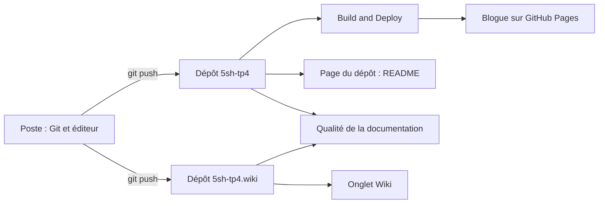

# PocketBase en équipe

Dépôt du projet de documentation PocketBase : un README pour reproduire le projet, un wiki pour apprendre et dépanner, un blogue pour comprendre et décider.

[](https://github.com/202430022/5sh-tp4/actions/workflows/pages-deploy.yml)
[](https://github.com/202430022/5sh-tp4/actions/workflows/qualite.yml)

- Blogue : [202430022.github.io/5sh-tp4](https://202430022.github.io/5sh-tp4/)
- Wiki : [github.com/202430022/5sh-tp4/wiki](https://github.com/202430022/5sh-tp4/wiki)

## Sommaire

- [Prérequis](#prérequis)
- [Démarrage rapide](#démarrage-rapide)
- [Structure du dépôt](#structure-du-dépôt)
- [Publication du blogue](#publication-du-blogue)
- [Personnalisation du thème](#personnalisation-du-thème)
- [Contrôle qualité](#contrôle-qualité)
- [Fonctionnement](#fonctionnement)
- [Licences et crédits](#licences-et-crédits)
- [Sources](#sources)

## Prérequis

| Outil | Version | Rôle |
|---|---|---|
| Système | Windows 10 ou 11, macOS 12 ou plus, ou distribution Linux récente | Exécuter PocketBase et Git |
| PowerShell | 5.1 ou 7.x | Commandes du démarrage rapide sous Windows |
| Git | 2.40 ou plus | Cloner le dépôt et publier les modifications |
| PocketBase | 0.40.6 | Serveur, base SQLite, API et console |
| Ruby | 3.4, facultatif | Aperçu local du blogue seulement |

PocketBase se télécharge sur la page des versions du dépôt officiel. Sous macOS ou Linux, l'exécutable s'appelle `pocketbase` et non `pocketbase.exe` ; les commandes sont identiques pour le reste.

## Démarrage rapide

1. Cloner le dépôt et entrer dans le dossier.

    ```powershell
    git clone https://github.com/202430022/5sh-tp4.git
    cd 5sh-tp4
    ```

2. Télécharger PocketBase 0.40.6 pour Windows et l'extraire dans `pocketbase/`.

    ```powershell
    Invoke-WebRequest "https://github.com/pocketbase/pocketbase/releases/download/v0.40.6/pocketbase_0.40.6_windows_amd64.zip" -OutFile pocketbase/pb.zip
    Expand-Archive pocketbase/pb.zip -DestinationPath pocketbase
    ```

3. Créer le compte administrateur. Remplacer les valeurs entre chevrons.

    ```powershell
    cd pocketbase
    .\pocketbase.exe superuser create <COURRIEL> "<MOT_DE_PASSE>"
    ```

4. Démarrer le serveur.

    ```powershell
    .\pocketbase.exe serve --http=127.0.0.1:8090
    ```

5. Ouvrir [127.0.0.1:8090/_/](http://127.0.0.1:8090/_/) et se connecter avec le compte créé.

6. Vérifier que les trois collections `equipements`, `membres` et `prets` apparaissent. Elles sont recréées automatiquement à partir de `pocketbase/pb_migrations/` au premier démarrage.

La suite — créer un premier équipement, vérifier les règles avec deux comptes, sauvegarder et restaurer — est dans le tutoriel du wiki : [Premiers pas avec PocketBase](https://github.com/202430022/5sh-tp4/wiki/Premiers-pas).

## Structure du dépôt

```text
5sh-tp4/
├── .github/workflows/
│   ├── pages-deploy.yml      construction et publication du blogue
│   └── qualite.yml           vérification du Markdown et des liens
├── _config.yml               configuration du site et du thème
├── _data/origin/cors.yml     polices et bibliothèques chargées par le thème
├── _posts/                   les cinq articles du blogue
├── _tabs/                    pages À propos et Documentation
├── assets/css/               personnalisation des couleurs et des polices
├── pocketbase/pb_migrations/ schéma des collections, versionné
├── .markdownlint.jsonc       règles de Markdown du README
└── README.md                 ce document
```

`pocketbase/pb_data/`, l'exécutable et l'archive ne sont pas versionnés : ce sont des données locales, pas du code. Le fichier `.gitignore` les exclut.

## Publication du blogue

Le blogue est un site Jekyll construit par Chirpy. Chaque `push` sur la branche `main` déclenche le workflow **Build and Deploy**, qui construit le site, vérifie ses liens internes avec HTML-Proofer, puis le publie sur GitHub Pages.

Le site est en ligne à l'adresse [202430022.github.io/5sh-tp4](https://202430022.github.io/5sh-tp4/). La source de publication doit être réglée sur **GitHub Actions** dans les paramètres Pages du dépôt.

Un aperçu local est possible, mais facultatif : il demande Ruby 3.4 et les gems du projet.

```bash
bundle install
bundle exec jekyll serve
```

## Personnalisation du thème

Trois fichiers modifient l'apparence du site :

| Fichier | Rôle |
|---|---|
| `assets/css/jekyll-theme-chirpy.scss` | Palette de couleurs et familles de polices |
| `_data/origin/cors.yml` | Adresse des polices Google Fonts et bibliothèques |
| `_config.yml` | Mode clair imposé, langue française, adresse du site |

Les rapports de contraste sont calculés selon la formule du WCAG 2.2, avec le vérificateur WebAIM.

| Élément | Couleur du texte | Couleur de fond | Contraste |
|---|---|---|---|
| Texte courant | `#1f2933` | `#fbfaf7` | 14,14:1 |
| Titres | `#0b3d3b` | `#fbfaf7` | 11,53:1 |
| Liens | `#0b5d7a` | `#fbfaf7` | 7,03:1 |
| Texte discret | `#5b6666` | `#fbfaf7` | 5,69:1 |
| Titre du site | `#0b3d3b` | `#eef3f0` | 10,73:1 |
| Texte de la barre latérale | `#3f4a4a` | `#eef3f0` | 8,17:1 |

Tous les rapports dépassent le minimum de 4,5:1 exigé pour le texte courant. Les polices sont **Inter** pour le texte et **Source Serif 4** pour les titres, chargées depuis Google Fonts et déclarées dans le fichier SCSS du thème.

## Contrôle qualité

Deux workflows vérifient le dépôt à chaque `push`.

| Workflow | Fichier | Ce qu'il vérifie |
|---|---|---|
| Build and Deploy | `.github/workflows/pages-deploy.yml` | Construction Jekyll, liens internes du site avec HTML-Proofer, puis publication |
| Qualité de la documentation | `.github/workflows/qualite.yml` | Syntaxe du README, des articles et du wiki avec markdownlint ; liens du README et du wiki avec lychee |

Pour lire un échec, ouvrir l'onglet **Actions**, choisir l'exécution en rouge, puis le travail en échec. markdownlint indique le fichier et le numéro de ligne ; lychee indique l'adresse fautive et le code de réponse.

Le wiki est un dépôt distinct. Un `push` dans le wiki ne déclenche pas toujours la vérification : après une modification, si aucune exécution n'apparaît, ouvrir **Actions**, choisir **Qualité de la documentation**, puis **Run workflow**.

## Fonctionnement



## Licences et crédits

| Composant | Licence | Source |
|---|---|---|
| PocketBase | MIT | [github.com/pocketbase/pocketbase](https://github.com/pocketbase/pocketbase) |
| Chirpy, thème Jekyll | MIT | [github.com/cotes2020/jekyll-theme-chirpy](https://github.com/cotes2020/jekyll-theme-chirpy) |

Le scénario du prêt d'équipement, les captures et les textes sont originaux. Les messages d'erreur cités proviennent de manipulations réelles sur PocketBase 0.40.6.

## Sources

- Georgiev, G. *PocketBase — Release v0.40.6*, [github.com/pocketbase/pocketbase/releases/tag/v0.40.6](https://github.com/pocketbase/pocketbase/releases/tag/v0.40.6), 2026.
- PocketBase. *Introduction*, [pocketbase.io/docs](https://pocketbase.io/docs/), 2026.
- PocketBase. *API rules and filters*, [pocketbase.io/docs/api-rules-and-filters](https://pocketbase.io/docs/api-rules-and-filters/), 2026.
- PocketBase. *API Records*, [pocketbase.io/docs/api-records](https://pocketbase.io/docs/api-records/), 2026.
- Chung, C. *chirpy-starter*, [github.com/cotes2020/chirpy-starter](https://github.com/cotes2020/chirpy-starter), 2026.
- GitHub. *Configuring a publishing source for your GitHub Pages site*, [docs.github.com](https://docs.github.com/en/pages/getting-started-with-github-pages/configuring-a-publishing-source-for-your-github-pages-site), 2026.
- GitHub. *About wikis*, [docs.github.com](https://docs.github.com/en/communities/documenting-your-project-with-wikis/about-wikis), 2026.
- GitHub. *Creating diagrams*, [docs.github.com](https://docs.github.com/en/get-started/writing-on-github/working-with-advanced-formatting/creating-diagrams), 2026.
- W3C. *Understanding SC 1.4.3: Contrast (Minimum)*, [w3.org](https://www.w3.org/WAI/WCAG22/Understanding/contrast-minimum.html), 2026.
- WebAIM. *Contrast Checker*, [webaim.org/resources/contrastchecker](https://webaim.org/resources/contrastchecker/), 2026.
