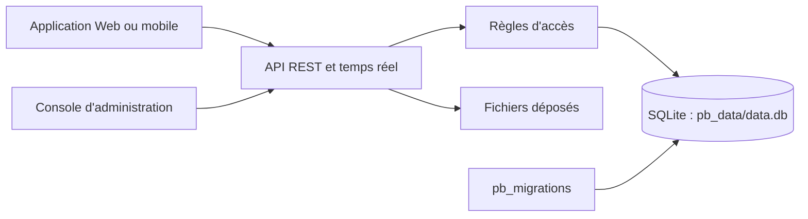

Un backend, en général, c'est une pile : un serveur, une base de données, un système d'authentification, un service de fichiers, et autant de fichiers de configuration que de briques. PocketBase propose l'inverse : un exécutable de 34 Mo qui contient tout cela, se lance en une commande et s'administre dans un navigateur. Ce premier article présente la série, explique ce que le fichier contient vraiment, et annonce les quatre textes qui suivent.

## Ce que contient l'exécutable

PocketBase est écrit en Go et publié sous licence MIT. Un seul binaire suffit : il embarque une base SQLite, une API REST, une API temps réel, une gestion des comptes, un stockage de fichiers, un système de sauvegarde et une console d'administration. Il n'y a ni conteneur à orchestrer, ni service externe à payer pour démarrer.

La base de données n'est pas un détail : SQLite est un fichier unique, lu et écrit directement par le processus. Cela explique une bonne partie des qualités et des limites de l'outil. Les données vivent dans `pb_data/`, un dossier créé au premier lancement. Les règles d'accès, elles, sont du code JavaScript stocké sous forme de migrations dans `pb_migrations/`. Cette séparation est la clé de la reproductibilité : le schéma se versionne, les données ne se versionnent pas.

Le schéma suivant résume le trajet d'une requête.

La console n'a aucun privilège particulier : elle utilise la même API que n'importe quel client. C'est une bonne nouvelle pour comprendre l'outil, parce qu'une manipulation dans l'interface correspond toujours à une requête qu'on peut reproduire dans un terminal.

Le projet de la série applique ce modèle à un scénario simple : un laboratoire prête du matériel — projecteurs, ordinateurs, caméras — à des étudiants. Trois collections suffisent. `equipements` décrit l'inventaire, `membres` contient les comptes et les rôles, `prets` relie un équipement à un membre. Deux rôles, `etudiant` et `technicien`, distinguent celui qui réserve de celui qui valide un retour. Le scénario est volontairement petit : il tient dans une page, et il permet de tester chaque comportement sans données artificielles.

## Trois lecteurs, trois documents

La série ne s'adresse pas à un public unique. Un débutant veut installer et voir fonctionner ; une personne qui développe veut comprendre les règles d'accès ; une équipe qui hésite veut comparer avant de s'engager. Ces besoins ne se satisfont pas avec le même texte.

C'est pourquoi la documentation de ce projet se répartit en trois endroits. Le dépôt GitHub contient un README qui permet de reproduire le projet. Le wiki contient les procédures, les références et le dépannage. Ce blogue contient le récit, l'analyse et l'avis. Une information ne vit qu'à un seul endroit : les autres textes y renvoient.

## Le plan de la série

Le [deuxième article]() raconte l'installation et les premiers pas, avec l'erreur qui m'a le plus appris : un port déjà occupé et un message d'erreur que j'ai d'abord mal interprété.

Le [troisième article]() analyse les règles d'accès. PocketBase distingue trois états — verrouillée, vide, expression — et cette distinction explique la plupart des réponses 403 et 400 que l'on rencontre au début.

Le [quatrième article]() compare PocketBase à Supabase sur des critères annoncés d'avance : licence, modèle de données, authentification, fichiers, temps réel, apprentissage et coût.

Le [cinquième article]() donne un avis motivé : à quel petit projet d'équipe PocketBase convient, à quel projet il ne convient pas, et ce que cet avis ne couvre pas.

Les articles se lisent dans l'ordre, mais chacun se tient seul. Les procédures détaillées, elles, restent dans le wiki, pour éviter qu'une même commande soit écrite deux fois et finisse par diverger.

## Ce que la série ne promet pas

PocketBase n'est pas un substitut à PostgreSQL pour une équipe de vingt développeurs, et cette série ne prétend pas le contraire. Elle documente un usage précis : un petit projet, une équipe réduite, un besoin de livrer vite sans administrer d'infrastructure. Les limites observées sont décrites dans le dernier article, avec les cas où je déconseille l'outil.

## Sources

- Georgiev, G. *PocketBase — Release v0.40.6*, [github.com/pocketbase/pocketbase/releases/tag/v0.40.6](https://github.com/pocketbase/pocketbase/releases/tag/v0.40.6), 2026.
- PocketBase. *Introduction*, [pocketbase.io/docs](https://pocketbase.io/docs/), 2026.
- PocketBase. *API rules and filters*, [pocketbase.io/docs/api-rules-and-filters](https://pocketbase.io/docs/api-rules-and-filters/), 2026.
