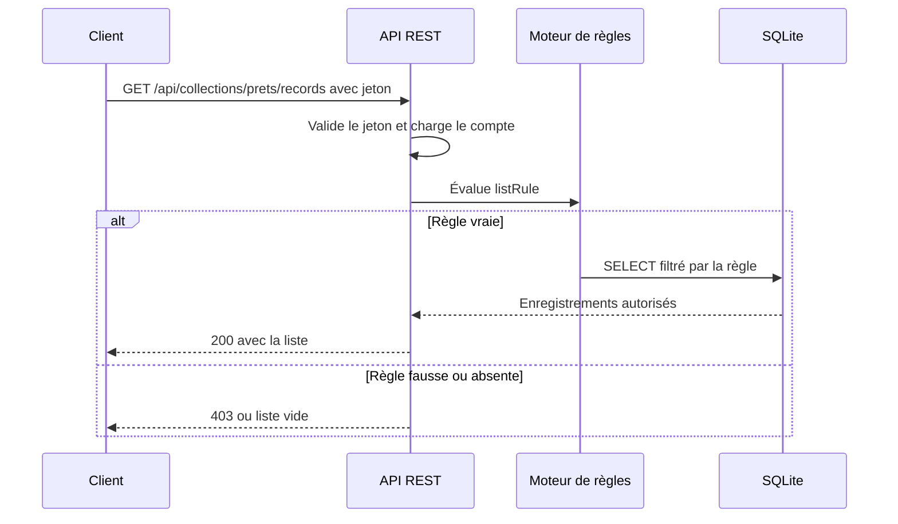

Une règle d'accès à `null`, une règle à `""` et une règle qui contient une expression ne produisent pas trois nuances de la même chose : ce sont trois comportements distincts. Confondre les deux premières est l'erreur la plus fréquente quand on débute, et c'est aussi celle qui produit les messages les plus déroutants. Cet article analyse les trois états, puis les vérifie avec deux comptes réels.

## Trois états, pas un

Dans PocketBase, chaque opération d'une collection possède sa propre règle : `listRule`, `viewRule`, `createRule`, `updateRule` et `deleteRule`. Chacune peut prendre trois formes.

| Valeur de la règle | Qui passe | Effet observable |
|---|---|---|
| `null` | Les superusers seulement | Erreur 403, même en lecture |
| `""` (chaîne vide) | Tout le monde, y compris sans jeton | Lecture publique, écriture publique |
| Une expression | Les requêtes pour lesquelles l'expression est vraie | Résultat filtré, ou refus |

Le point contre-intuitif est le suivant : `null` ne veut pas dire « aucune règle, donc tout est permis ». Cela veut dire « aucune règle n'accorde l'accès », donc personne, sauf un superuser. La chaîne vide est l'inverse exact : elle accorde l'accès à tous. Entre les deux, l'expression est évaluée pour chaque requête, avec le contexte de l'utilisateur authentifié.

Sur la collection `membres` du projet, la lecture est verrouillée : elle contient des courriels et des rôles, et rien ne justifie qu'un client anonyme les liste. Sur `equipements`, la lecture est publique : l'inventaire du laboratoire n'a rien de secret. Sur `prets`, la lecture est une expression, parce qu'un étudiant doit voir ses emprunts et le technicien doit voir tous les emprunts.

## Le trajet d'une requête

Le schéma suivant montre l'ordre des opérations pour une lecture de la collection `prets`.



Deux détails de ce schéma ont des conséquences pratiques. D'abord, la règle est évaluée avant la requête SQL : elle ne filtre pas un résultat déjà chargé, elle restreint la sélection. Ensuite, l'identité du compte est chargée à partir du jeton, ce qui signifie que les champs personnalisés de la collection d'authentification — ici `role` — sont disponibles dans l'expression.

## La vérification avec deux comptes

J'ai créé deux comptes dans la collection `membres` : Alice, avec le rôle `etudiant`, et Benoît, avec le rôle `technicien`. Puis j'ai rejoué les mêmes requêtes avec chaque jeton, et une fois sans jeton. Voici les résultats réels.

| Requête | Jeton | Réponse obtenue |
|---|---|---|
| `GET /api/collections/membres/records` | aucun | 403, « Only superusers can perform this action. » |
| `GET /api/collections/equipements/records` | aucun | 200, liste complète |
| `POST /api/collections/equipements/records` | aucun | 400, « Failed to create record. » |
| `GET /api/collections/prets/records` | Alice | 200, un seul prêt, le sien |
| `GET /api/collections/prets/records` | Benoît | 200, deux prêts |
| `POST /api/collections/equipements/records` | Alice | 400, « Failed to create record. » |
| `POST /api/collections/equipements/records` | Benoît | 200, enregistrement créé |

Trois enseignements sortent de ce tableau. La règle verrouillée produit un 403 explicite, qui nomme les superusers : c'est le cas le plus lisible. La règle vide produit un 200 sans jeton : c'est le cas le plus dangereux si on l'applique par distraction à une collection sensible. Enfin, le refus d'écriture produit un 400 générique, identique pour un anonyme et pour un étudiant authentifié. PocketBase ne dit pas quelle règle a échoué, ni pourquoi.

Ce dernier point mérite d'être répété : un 400 à la création ne signifie pas nécessairement que les données sont invalides. Il peut signifier que la règle d'écriture a refusé la requête. Pour distinguer les deux, il faut lire la règle de la collection, puis reproduire l'appel avec un compte qui y satisfait.

## Ce que la migration montre

Les règles ne sont pas seulement des cases cochées dans une interface : elles finissent dans un fichier de migration, versionné avec le reste du projet. L'extrait suivant vient de la collection `prets`.

```js
migrate((app) => {
  const collection = new Collection({
    "createRule": "@request.auth.id != \"\"",
    "deleteRule": "@request.auth.role = \"technicien\"",
    "listRule": "@request.auth.id != \"\" && (membre = @request.auth.id || @request.auth.role = \"technicien\")",
    "name": "prets",
    "type": "base",
    "updateRule": "@request.auth.role = \"technicien\"",
    "viewRule": "@request.auth.id != \"\" && (membre = @request.auth.id || @request.auth.role = \"technicien\")"
  })
  // ... définition des champs equipement, membre, date_debut, date_retour_prevue, retourne
}, (app) => {
  // ... suppression de la collection au retour arrière
})
```
{: file="pocketbase/pb_migrations/1795652614_created_prets.js" }

La règle de lecture se lit comme une phrase : l'utilisateur doit être authentifié, et il doit être soit le membre associé au prêt, soit un technicien. La règle de création est plus permissive — tout compte authentifié peut créer un prêt — mais la règle de mise à jour est réservée aux techniciens. C'est cohérent avec le scénario : un étudiant réserve, un technicien valide le retour.

## Ce que j'en retiens

Une règle d'accès n'est pas une permission abstraite : c'est une expression évaluée à chaque requête, avec un coût et un contexte. Écrire `""` par facilité revient à publier la collection. Écrire `null` par prudence revient à la rendre invisible, y compris pour l'application. Et une expression doit être testée avec au moins deux comptes de rôles différents, sinon on ne vérifie que le cas qui marche.

La procédure de vérification, avec les commandes et les deux comptes, est décrite dans le wiki : [Vérifier les règles d'accès](https://github.com/202430022/5sh-tp4/wiki/Verifier-les-regles-dacces). Les valeurs des règles, elles, sont dans la référence : [Règles d'accès des collections](https://github.com/202430022/5sh-tp4/wiki/Regles-dacces).

## Sources

- PocketBase. *API rules and filters*, [pocketbase.io/docs/api-rules-and-filters](https://pocketbase.io/docs/api-rules-and-filters/), 2026.
- PocketBase. *API Records*, [pocketbase.io/docs/api-records](https://pocketbase.io/docs/api-records/), 2026.
- Microsoft. *Invoke-RestMethod*, [learn.microsoft.com/en-us/powershell/module/microsoft.powershell.utility/invoke-restmethod](https://learn.microsoft.com/en-us/powershell/module/microsoft.powershell.utility/invoke-restmethod), 2026.
